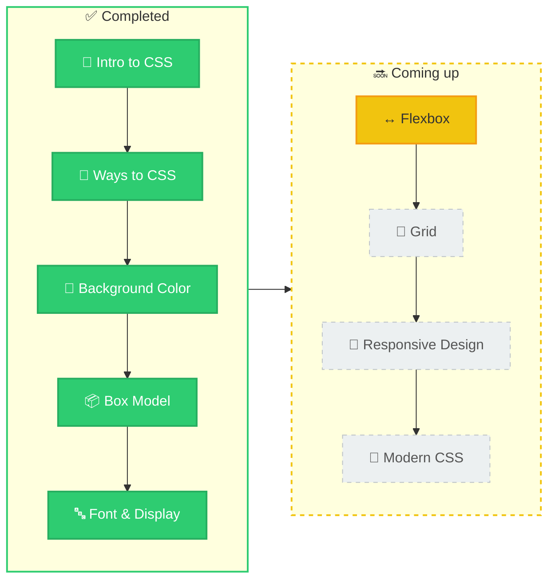

[Overview](#-overview) · [Course Info](#-course-info) · [Topics](#-topics-covered) · [Skills](#-skills-gained) · [Syntax](#-syntax--key-concepts) · [Certificate](#-certificate) · [Links](#-reference--links) · [Next Steps](#-key-takeaways--next-steps)

## 📖 Overview

CSS is the language that controls how web pages look: layout, colors, typography, spacing, and motion. This course takes me from the basics — how HTML and CSS work together — through selectors, colors, and backgrounds, and on to the box model, Flexbox, Grid, and responsive design.

🎯 **Why I took it:** to build a strong foundation in CSS and gradually create beautiful, responsive, modern websites.

## 📋 Course Info

| Field | Details |
|:--|:--|
| 🎓 **Course Name** | Learning CSS |
| 🏫 **Platform / Provider** | [PLATFORM, e.g. GeeksforGeeks, Coursera, Udemy] |
| ⏳ **Duration** | [DURATION, e.g. 20 hours] |
| 📌 **Completion Status** | [Completed / In Progress] |
| 📅 **Completion Date** | [DATE, if completed] |

## 📚 Topics Covered

### 🧭 Learning Roadmap

🟩🟩🟩🟩🟩⬜⬜⬜⬜ **5 of 9 steps completed**

> 🟩 **Completed** · 🟨 **Up next** · ⬜ **Planned**

### 🧱 Modules

<table width="100%">
  <tr>
    <td align="center" valign="top" width="33%">
      
      <h3>🌱 Intro to CSS</h3>
      
What CSS is, how HTML (structure) and CSS (style) work together, and writing a first rule.

      <a href="https://github.com/vinayakmishra4/Learning-CSS/tree/main/Intro-to-css"><b>📂 Explore</b></a>
    </td>
    <td align="center" valign="top" width="33%">
      
      <h3>🔗 Ways to CSS</h3>
      
The three ways to add CSS — inline, internal, and external — plus element, class, and ID selectors.

      <a href="https://github.com/vinayakmishra4/Learning-CSS/tree/main/Ways-to-CSS"><b>📂 Explore</b></a>
    </td>
    <td align="center" valign="top" width="33%">
      
      <h3>🎨 Background Color</h3>
      
<code>background-color</code>, images, gradients, and color formats — names, HEX, RGB/RGBA, HSL/HSLA.

      <a href="https://github.com/vinayakmishra4/Learning-CSS/tree/main/Coluring-Background"><b>📂 Explore</b></a>
    </td>
  </tr>
  <tr>
    <td align="center" valign="top" width="33%">
      
      <h3>📦 Box Model</h3>
      
Content, padding, border, and margin; width and height; margin collapse; and <code>box-sizing</code>.

      <a href="https://github.com/vinayakmishra4/Learning-CSS/tree/main/BOX-Model"><b>📂 Explore</b></a>
    </td>
    <td align="center" valign="top" width="33%">
      
      <h3>🔤 Font &amp; Display</h3>
      
The <code>display</code> property (inline, block, inline-block), <code>text-align</code>, and fonts — <code>font-family</code>, <code>font-size</code>, and <code>line-height</code>.

      <a href="https://github.com/vinayakmishra4/Learning-CSS/tree/main/Font-Display"><b>📂 Explore</b></a>
    </td>
    <td align="center" valign="top" width="33%">
      
      <h3>🚧 Coming Soon</h3>
      
More modules are on the way — this list grows as I learn.

    </td>
  </tr>
</table>

## 🔧 Skills Gained

- ✅ **HTML + CSS together** — applying CSS to HTML with inline, internal, and external styles
- ✅ **CSS syntax** — writing rules with selectors, properties, and values
- ✅ **Selectors** — targeting elements with element, ID, and class selectors, including multiple classes
- ✅ **Text styling** — aligning and coloring text, and setting `font-family`, `font-size`, and `line-height`
- ✅ **Backgrounds** — setting background colors and images, plus size, repeat, position, and gradients
- ✅ **Color formats** — using color names, HEX, RGB/RGBA, and HSL/HSLA values
- ✅ **Box model** — working with content, padding, border, and margin, plus `box-sizing`
- ✅ **Spacing & borders** — setting width, height, margin, padding, and border, including shorthand values and margin collapse
- ✅ **Display** — controlling how elements flow with `inline`, `block`, and `inline-block`

## 🧩 Syntax & Key Concepts

> [!TIP]
> Words like `selector`, `property`, and `value` below are placeholders — swap in real names and values when writing CSS.

### General Syntax Patterns

| Concept | Pattern |
|:--|:--|
| Rule set | `selector { property: value; }` |
| Element selector | `element-name { property: value; }` |
| Universal selector | `* { property: value; }` |
| ID selector | `#id-name { property: value; }` |
| Class selector | `.class-name { property: value; }` |
| Inline CSS | `<element style="property: value;">` |
| Internal CSS | `` |
| External CSS (link a stylesheet) | `<link rel="stylesheet" href="file-name.css">` |
| HEX color | `#RRGGBB` |
| RGB / RGBA color | `rgb(red, green, blue)` · `rgba(red, green, blue, alpha)` |
| HSL / HSLA color | `hsl(hue, saturation, lightness)` · `hsla(hue, saturation, lightness, alpha)` |
| Background image | `background-image: url('image-path');` |
| Four-value shorthand (margin, padding) | `property: top right bottom left;` |
| Border shorthand | `border: width style color;` |
| Font family | `font-family: font-name, generic-family;` |

### Key Concepts

| Concept | In a nutshell |
|:--|:--|
| 🏗️ **HTML · CSS · JS** | HTML gives structure, CSS gives style, and JavaScript adds behavior. |
| 🧭 **Three ways to add CSS** | Inline (on one element), internal (in a style element in the head), and external (a separate file — best for larger projects). |
| 🎯 **ID vs. Class** | An ID (`#`) targets one unique element; a class (`.`) can be reused on many elements and combined on one. |
| 🌈 **Color formats** | Names, HEX, RGB, and HSL define colors; the extra A in RGBA and HSLA adds transparency (alpha from 0 to 1). |
| 🖼️ **Backgrounds** | Color, image, repeat, position, size, and gradients control how an element's background looks. |
| 📦 **Box Model** | Every element is a box: content → padding → border → margin. |
| 🔄 **Margin Collapse** | Adjoining vertical margins overlap instead of adding up — 30px and 20px give a 30px gap, not 50px. |
| 📐 **Box Sizing** | `content-box` (the default) adds padding and border to the width; `border-box` includes them, so sizes are easier to predict. |
| 🧱 **Display** | `block` elements start on a new line, `inline` elements flow within a line, and `inline-block` flows inline but accepts width and height. |
| 👀 **Readability** | Good color combinations and strong contrast make text easier to read. |

## 🏅 Certificate

> **Certificate of Completion:** [Certificate](INSERT_CERTIFICATE_LINK_HERE)

## 🔗 Reference / Links

- 📂 [GitHub Repository](https://github.com/vinayakmishra4/Learning-CSS) — code and notes for every module
- 🌐 [Course Page](INSERT_COURSE_LINK_HERE) — the course this README documents
- 📘 [MDN Web Docs: CSS](https://developer.mozilla.org/en-US/docs/Web/CSS) — the go-to reference for CSS properties, values, and guides

## 🚀 Key Takeaways / Next Steps

**💡 Key Takeaways**

- Keeping HTML (structure) and CSS (style) in separate files keeps pages clean and easy to maintain.
- Classes make styles reusable, while IDs target a single element.
- The box model explains an element's real size and spacing — `border-box` makes sizing more predictable.
- Choosing readable color combinations matters as much as choosing attractive ones.

**🎯 Next Steps**

- [ ] Build layouts with **Flexbox** and **Grid**
- [ ] Make pages adapt to any screen with **responsive design**
- [ ] Explore **modern CSS** and apply it in small projects

---

⭐ **Found this helpful? Consider giving the repo a star!** ⭐

Made with ❤️ while learning CSS

