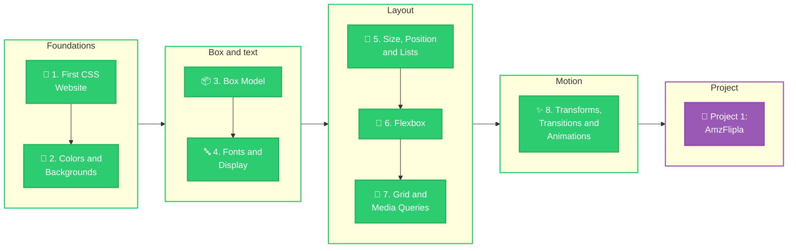

<h1 align="center"></h1>

[Overview](#-overview) · [Course Info](#-course-info) · [Roadmap](#-learning-roadmap) · [Project](#-project-1-e-commerce-website) · [Skills](#-skills-gained) · [Certificate](#-certificate) · [Links](#-reference--links) · [Next Steps](#-key-takeaways--next-steps)

**Parts:** [🌱 1](#-part-1-creating-your-first-css-website) · [🎨 2](#-part-2-colors-and-backgrounds) · [📦 3](#-part-3-the-css-box-model) · [🔤 4](#-part-4-fonts-and-display) · [📏 5](#-part-5-size-position-and-lists) · [🧩 6](#-part-6-flexbox) · [🧱 7](#-part-7-css-grid-and-media-queries) · [✨ 8](#-part-8-transforms-transitions-and-animations)

## 📖 Overview

CSS is the language that controls how web pages look: layout, colors, typography, spacing, and motion. This README follows my CSS notes in **8 parts**, from the first selector to transforms and animations, and ends with a **project** that puts it all together. Each part lists what I learned, the syntax to remember, the practice set from my notes, and a link to my code.

🎯 **Why I took it:** to build a strong foundation in CSS and gradually create beautiful, responsive, modern websites.

## 📋 Course Info

| Field | Details |
|:--|:--|
| 🎓 **Course Name** | Learning CSS |
| 🏫 **Platform / Provider** | [PLATFORM, e.g. GeeksforGeeks, Coursera, Udemy] |
| ⏳ **Duration** | [DURATION, e.g. 20 hours] |
| 🧭 **Structure** | 8 parts and 1 project |
| 📌 **Completion Status** | [Completed / In Progress] |
| 📅 **Completion Date** | [DATE, if completed] |

## 🧭 Learning Roadmap

🟩🟩🟩🟩🟩🟩🟩🟩🟪 **8 parts covered and 1 project built**

> 🟩 **Covered in my notes** · 🟪 **Built as a project**

## 🌱 Part 1: Creating Your First CSS Website

> 🟢 **Part 1 of 8** — how HTML and CSS fit together, the three ways to add CSS, and how to select elements.

**What I learned**

- HTML is the skeleton of a page; CSS (Cascading Style Sheets) styles it and makes it look good on any screen.
- The DOM is the tree of objects the browser builds from the page.
- An `id` identifies one unique element; a `class` can be shared by many elements, and one element can have several classes separated by spaces.
- Three ways to add CSS: the `` |
| External CSS | `<link rel="stylesheet" href="file-name.css">` |
| Comment | `/* comment text */` |

<b>Practice set from my notes</b>

1. Create a website with a class `red` div that has a red background color and white text color.
2. Create an element with the id `head` and check that the background color works on it as inline CSS, external CSS, and with the `<style>` tag.
3. Create a CSS class `one` and check that it works on multiple elements.
4. Create multiple CSS classes and check that all of them work on the same element.
5. Look at the MDN CSS reference and play around with a few key-value CSS rules.

📂 **Code:** [Intro-to-css](https://github.com/vinayakmishra4/Learning-CSS/tree/main/Intro-to-css) and [Ways-to-CSS](https://github.com/vinayakmishra4/Learning-CSS/tree/main/Ways-to-CSS)

## 🎨 Part 2: Colors and Backgrounds

> 🔵 **Part 2 of 8** — coloring text and containers, and controlling background images.

**What I learned**

- `color` sets the text color and `background-color` sets a container's background.
- Color values come as RGB, HEX, or HSL (hue, saturation, lightness); RGBA and HSLA add an alpha value for transparency.
- `background-image` adds an image, which repeats in both directions by default.
- `background-repeat` takes `repeat-x`, `repeat-y`, or `no-repeat`.
- `background-size` takes `cover`, `contain`, `auto`, or a width and height.
- `background-position` places the image, and `background-attachment` makes it fixed or scrolling.
- The `background` shorthand sets several of these at once, and values can be skipped while the rest stay in order.

<b>Syntax to remember</b>

| Concept | Pattern |
|:--|:--|
| Text color | `color: value;` |
| Background color | `background-color: value;` |
| RGB | `rgb(red, green, blue)` |
| HEX | `#RRGGBB` |
| HSL | `hsl(hue, saturation, lightness)` |
| RGBA / HSLA | `rgba(red, green, blue, alpha)` · `hsla(hue, saturation, lightness, alpha)` |
| Background image | `background-image: url('image-path');` |
| Repeat | `background-repeat: value;` |
| Size | `background-size: value;` |
| Position | `background-position: horizontal vertical;` |
| Attachment | `background-attachment: value;` |
| Shorthand | `background: color image repeat attachment position;` |

<b>Practice set from my notes</b>

1. Create a dark blue navigation bar with light-colored items.
2. Change the color of the main container on your page to dark red.
3. Create a div and add a background image with a given width and height.
4. Create a vertical box and add a fixed, non-scrolling background to it.
5. Verify that the background shorthand property works with some of the values skipped.

📂 **Code:** [Coluring-Background](https://github.com/vinayakmishra4/Learning-CSS/tree/main/Coluring-Background)

## 📦 Part 3: The CSS Box Model

> 🟣 **Part 3 of 8** — how every element is a box, and how to control its size and spacing.

**What I learned**

- Every element is a box made of content, padding, border, and margin.
- The total space an element takes is its size plus the padding, border, and margin on both sides.
- `margin` and `padding` take one, two, or four values (four values go clockwise: top, right, bottom, left), and each side can also be set on its own.
- Borders have a width, style, and color, or can be set with the `border` shorthand; `border-radius` rounds the corners.
- Margin collapse: when two margins from different elements meet, the larger one wins.
- `box-sizing` is `content-box` by default (width covers only the content) or `border-box` (width includes padding and border).

<b>Syntax to remember</b>

| Concept | Pattern |
|:--|:--|
| Width and height | `width: length;` · `height: length;` |
| Margin and padding | `property: top right bottom left;` |
| Two-value shorthand | `property: top-and-bottom left-and-right;` |
| One side only | `margin-top: length;` · `padding-left: length;` |
| Border | `border: width style color;` |
| Border radius | `border-radius: length;` |
| Box sizing | `box-sizing: value;` |

<b>Practice set from my notes</b>

1. Create a website layout with a header box, one content box, and one footer.
2. Add borders and margins to the layout.
3. Did the margin collapse between the content box and the footer?
4. Add the `box-sizing` property to the content box. What changes did you notice?

📂 **Code:** [BOX-Model](https://github.com/vinayakmishra4/Learning-CSS/tree/main/BOX-Model)

## 🔤 Part 4: Fonts and Display

> 🔴 **Part 4 of 8** — how elements flow on the page, and how to style text and fonts.

**What I learned**

- `display` decides whether an element acts as `block` or `inline` and which layout (such as flex or grid) its children use.
- `inline` takes only the space it needs and ignores width and height; `block` takes the full width on its own line; `inline-block` sits inline but accepts width, height, margin, and padding.
- `display: none` removes an element from the flow, while `visibility: hidden` hides it but keeps its space.
- Text styling: `text-align`, `text-decoration`, `text-transform`, and `line-height`.
- `font-family` takes a fallback list, web-safe fonts work everywhere, and Google Fonts can be added through the stylesheet.
- Other font properties: `font-size`, `font-style`, `font-variant`, and `font-weight`, plus generic families like serif and sans-serif.

<b>Syntax to remember</b>

| Concept | Pattern |
|:--|:--|
| Display | `display: value;` |
| Visibility | `visibility: value;` |
| Text alignment | `text-align: value;` |
| Text decoration | `text-decoration: value;` |
| Text transform | `text-transform: value;` |
| Line height | `line-height: number;` |
| Font family with fallbacks | `font-family: "font-name", generic-family;` |
| Other font properties | `font-size: length;` · `font-style: value;` · `font-variant: value;` · `font-weight: value;` |

<b>Practice set from my notes</b>

1. Create a website layout with a black navbar, a red div, and a green div.
2. Add a footer with the Google font "Ballu Bhai" to the layout.
3. Remove the underlines from the links in the layout.
4. Demonstrate the difference between `display: none` and `visibility: hidden` using a div.
5. Change the footer to all uppercase.

📂 **Code:** [Font-Display](https://github.com/vinayakmishra4/Learning-CSS/tree/main/Font-Display)

## 📏 Part 5: Size, Position and Lists

> 🟠 **Part 5 of 8** — flexible units, positioning, stacking order, and list styling.

**What I learned**

- Pixels depend on the viewing device, so relative units adapt better: `em` (parent font size), `rem` (root font size), `vw` and `vh` (1% of the viewport width and height), and `%` (relative to the parent).
- `min-width`, `max-width`, `min-height`, and `max-height` set limits on an element's size.
- `position` can be `static` (the default), `relative`, `absolute` (relative to the nearest non-static ancestor), `fixed` (relative to the browser window), or `sticky` (based on scroll position).
- `top`, `right`, `bottom`, `left`, and `z-index` take effect once an element is positioned.
- `z-index` sets the stacking order when elements overlap.
- `list-style` is a shorthand for a list's type, position, and image.

<b>Syntax to remember</b>

| Concept | Pattern |
|:--|:--|
| Length with a unit | `property: <number><unit>;` |
| Size limits | `min-width: length;` · `max-width: length;` · `min-height: length;` · `max-height: length;` |
| Position | `position: value;` |
| Offsets | `top: length;` · `right: length;` · `bottom: length;` · `left: length;` |
| Stacking order | `z-index: number;` |
| List shorthand | `list-style: type position image;` |

<b>Practice set from my notes</b>

1. Create a responsive navbar using relative lengths.
2. Create a sticky navbar using the `position` property.
3. Demonstrate the use of the `list-style` property using a `ul` as an example.
4. Demonstrate the use of `z-index` using an example.

📂 **Code:** [Size-Postions-Lists](https://github.com/vinayakmishra4/Learning-CSS/tree/main/Size-Postions-Lists)

## 🧩 Part 6: Flexbox

> 🟡 **Part 6 of 8** — float and clear first, then Flexbox for laying out and aligning items in a container.

**What I learned**

- `float` pushes an element to the left or right, and `clear` controls which elements can float beside a given element.
- Flexbox lays out, aligns, and distributes space among the items in a container; `display: flex` makes the container, and its children become flex items.
- A flex container has a main axis and a cross axis (the cross axis is not always vertical).
- `flex-direction` can be `row` (the default), `row-reverse`, `column`, or `column-reverse`.
- Container properties: `flex-wrap`, `justify-content` (main axis), `align-items` (cross axis), and `align-content` (spacing between lines).
- Item properties: `order`, `align-self`, `flex-grow`, and `flex-shrink`.

<b>Syntax to remember</b>

| Concept | Pattern |
|:--|:--|
| Float and clear | `float: value;` · `clear: value;` |
| Flex container | `display: flex;` |
| Direction | `flex-direction: value;` |
| Wrapping | `flex-wrap: value;` |
| Container alignment | `justify-content: value;` · `align-items: value;` · `align-content: value;` |
| Item order and alignment | `order: number;` · `align-self: value;` |
| Grow and shrink | `flex-grow: number;` · `flex-shrink: number;` |

<b>Practice set from my notes</b>

1. Create a layout of your choice using float.
2. Create the same layout using Flexbox.
3. Create a navigation bar (Home, About, Contact) using Flexbox.
4. Create a layout with a navigation bar, a background-image header, and three images using Flexbox.

📂 **Code:** [Flexbox](https://github.com/vinayakmishra4/Learning-CSS/tree/main/Flexbox) (the float and clear practice)

## 🧱 Part 7: CSS Grid and Media Queries

> 🟤 **Part 7 of 8** — two-dimensional layouts with Grid, and styles that respond to screen size.

**What I learned**

- `display: grid` makes a grid container, and its direct children become grid items.
- `grid-column-gap`, `grid-row-gap`, and the `grid-gap` shorthand (row first, then column) set the spacing; a single value sets both.
- Container properties: `grid-template-columns`, `grid-template-rows`, `justify-content`, and `align-content`.
- Item properties: `grid-column` and `grid-row` set how many columns or rows an item spans, for example starting at column 1 and spanning 3.
- Media queries apply CSS only when a condition is true, such as a maximum screen width, which is what makes a page responsive.
- My practice page combines both: a grid that changes its columns and background color across large, medium, and small screens.

<b>Syntax to remember</b>

| Concept | Pattern |
|:--|:--|
| Grid container | `display: grid;` |
| Column and row sizes | `grid-template-columns: size size size;` · `grid-template-rows: size size;` |
| Gaps | `grid-gap: row-gap column-gap;` |
| Item spanning | `grid-column: start / end;` · `grid-row: start / end;` · `grid-column: start / span count;` |
| Media query | `@media only screen and (max-width: width) { selector { property: value; } }` |

<b>Practice set from my notes</b>

1. Create a header with content using CSS Grid.
2. Create the layouts from the Part 6 practice set using CSS Grid.
3. Create a webpage that is green on large devices, red on medium devices, and yellow on small devices.

📂 **Code:** [Gridbox](https://github.com/vinayakmishra4/Learning-CSS/tree/main/Gridbox)

## ✨ Part 8: Transforms, Transitions and Animations

> ⚫ **Part 8 of 8** — moving, resizing, and animating elements.

**What I learned**

- Transforms rotate, move, skew, or scale elements, and `transform-origin` sets the point they transform around.
- 2D methods: `translate()`, `rotate()`, `scale()`, `scaleX()`, `scaleY()`, `skew()`, and `matrix()`; 3D methods: `rotateX()`, `rotateY()`, and `rotateZ()`.
- Transitions change property values smoothly using a property, duration, timing function, and delay, and several properties can transition at once.
- Animations use an `@keyframes` rule (from and to, or percentage steps) plus the animation name, duration, timing function, delay, iteration count, and direction.
- Both have a shorthand: `transition` and `animation`.

<b>Syntax to remember</b>

| Concept | Pattern |
|:--|:--|
| Transform | `transform: method(value);` |
| Transform origin | `transform-origin: x y;` |
| Transition | `transition: property duration timing-function delay;` |
| Multiple transitions | `transition: property-1 duration-1, property-2 duration-2;` |
| Keyframes (from and to) | `@keyframes name { from { property: value; } to { property: value; } }` |
| Keyframes (percentages) | `@keyframes name { 0% { property: value; } 100% { property: value; } }` |
| Animation | `animation: name duration timing-function delay iteration-count direction;` |

<b>Practice set from my notes</b>

1. Create a thin progress bar animation for a website.
2. Create the same progress bar using a transition.
3. Create a rotating image animation using CSS.
4. Create a slider with three images using CSS.

📂 **Code:** [2D-Transfromartion-css](https://github.com/vinayakmishra4/Learning-CSS/tree/main/2D-Transfromartion-css)

## 🛒 Project 1: E-Commerce Website

> 🟣 **Project 1** — **AmzFlipla**, a responsive shopping homepage built with HTML, CSS, and JavaScript. It answers the project at the end of my notes: create a homepage for an e-commerce website and use media queries to make it responsive.

AmzFlipla is inspired by Amazon and Flipkart. The page has a header with search and a cart counter, a hero section, shopping categories, deals, product cards, a newsletter form, and a footer.

**What it does**

| Feature | How it works |
|:--|:--|
| 🔍 Product search | Type a name and press Enter or click search; cards that do not match are hidden, and a message appears when nothing is found |
| 🛒 Shopping cart | Each Add to Cart button raises the cart counter in the header |
| 🏷️ Categories | Electronics, Fashion, Home, Accessories, and Footwear |
| 📩 Newsletter | An email form that thanks the visitor for subscribing |
| ☰ Mobile menu | The navigation links collapse into a menu button on small screens |

**Where my notes show up**

| Part | In the project |
|:--|:--|
| [🧱 Part 7](#-part-7-css-grid-and-media-queries) | CSS Grid lays out the categories and product cards, and three media queries (900px, 650px, and 380px) change the columns and navigation for tablets and phones |
| [🧩 Part 6](#-part-6-flexbox) | Flexbox arranges the navbar, search box, links, and hero; `flex-wrap` and `order` move the search box onto its own row on small screens |
| [🔤 Part 4](#-part-4-fonts-and-display) | `display: none` and `display: block` hide the nav links and show the mobile menu on small screens |
| [✨ Part 8](#-part-8-transforms-transitions-and-animations) | Hover transitions and transforms on the category and product cards |
| [📦 Part 3](#-part-3-the-css-box-model) | `box-sizing` and `border-radius` for sizing and rounded corners |

🛠️ **Built with:** HTML5, CSS3, and JavaScript

📂 **Code:** [AmzFlipla-E-Commerce-Website](https://github.com/vinayakmishra4/AmzFlipla-E-Commerce-Website)

## 🔧 Skills Gained

- ✅ **Add and target** — apply CSS three ways and select elements by tag, id, class, group, or all at once
- ✅ **Color and backgrounds** — use RGB, HEX, and HSL colors, and control background images, size, repeat, and position
- ✅ **Spacing** — work with the box model: width, height, margin, padding, border, and `box-sizing`
- ✅ **Text and display** — style fonts with fallbacks and Google Fonts, and control how elements flow
- ✅ **Size and place** — use relative units, `position`, `z-index`, and `list-style`
- ✅ **Lay out pages** — build layouts with float, Flexbox, and Grid
- ✅ **Respond to screens** — apply styles with media queries
- ✅ **Add motion** — transform, transition, and animate elements
- ✅ **Build a project** — combine HTML, CSS, and a little JavaScript into a responsive e-commerce homepage

## 🏅 Certificate

> **Certificate of Completion:** [Certificate](INSERT_CERTIFICATE_LINK_HERE)

## 🔗 Reference / Links

- 📂 [GitHub Repository](https://github.com/vinayakmishra4/Learning-CSS) — code and notes for every part
- 🛒 [AmzFlipla E-Commerce Website](https://github.com/vinayakmishra4/AmzFlipla-E-Commerce-Website) — my Project 1, built with HTML, CSS, and JavaScript
- 🌐 [Course Page](INSERT_COURSE_LINK_HERE) — the course this README documents
- 📘 [MDN Web Docs: CSS](https://developer.mozilla.org/en-US/docs/Web/CSS) — the go-to reference for CSS properties, values, and guides

## 🚀 Key Takeaways / Next Steps

**💡 Key Takeaways**

- Keeping HTML (structure) and CSS (style) in separate files keeps pages clean and easy to maintain.
- Classes make styles reusable, while IDs target a single element.
- The box model explains an element's real size and spacing, and `border-box` makes sizing more predictable.
- Relative units, Flexbox, Grid, and media queries are the tools that make a layout adapt to any screen.
- Building AmzFlipla showed how they work together: Grid for the cards, Flexbox for the navigation, and media queries for each screen size.
- Transitions and animations add feedback and motion without any JavaScript.

**🎯 Next Steps**

- [ ] Add the planned features to **AmzFlipla**: a dedicated cart page, a wishlist, and product filters
- [ ] Go deeper into **JavaScript** so the cart, search, and filters work like a real store
- [ ] Keep exploring the **MDN CSS reference** and try more properties

---

⭐ **Found this helpful? Consider giving the repo a star!** ⭐

Made with ❤️ while learning CSS

